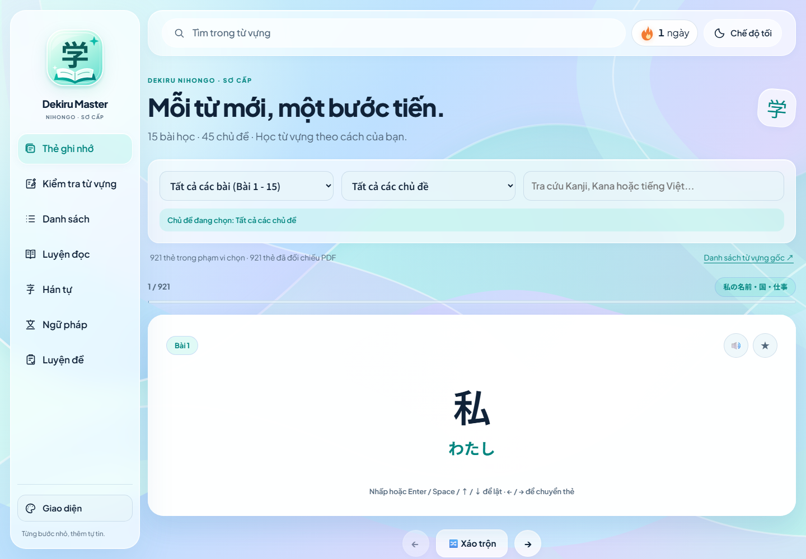
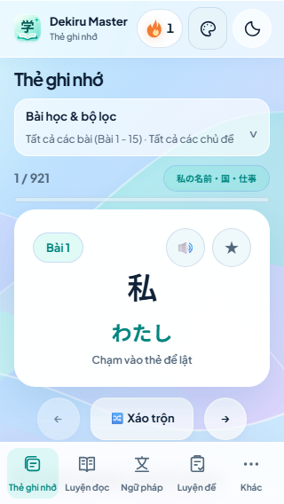
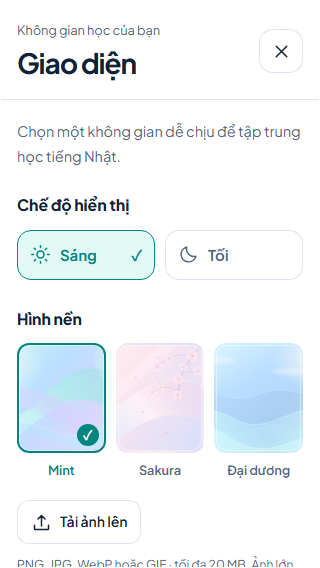

# Bằng chứng giao diện liquid glass — 23/10/2026

Đọc [báo cáo thiết kế/triển khai](../../GLASS_UI_REPORT.md). Ảnh được chụp bằng trình duyệt thật trong chế độ headless, không phải mockup. Những ảnh `glass-*` dùng bộ kiểm tra thao tác giao diện mới; `after-*` được tạo bởi bộ delivery/zoom hồi quy.

## Xem nhanh trước/sau

| Màn hình | Trước tại `11c7613` | Sau |
|---|---|---|
| Desktop 1440, sáng | [Ảnh cũ](before/before-home-1440-light.png) | [Ảnh mới](glass-flashcard-1440-light.png) |
| Desktop 1440, tối | [Ảnh cũ](before/before-home-1440-dark.png) | [Ảnh mới](glass-flashcard-1440-dark.png) |
| Tablet 768, sáng | [Ảnh cũ](before/before-home-768-light.png) | [Ảnh mới](glass-flashcard-768-light.png) |
| Mobile 390, sáng | [Ảnh cũ](before/before-home-390-light.png) | [Ảnh mới](glass-flashcard-390-light.png) |
| Mobile 320, tối | [Ảnh cũ](before/before-home-320-dark.png) | [Ảnh mới](glass-flashcard-320-dark.png) |
| Luyện đọc 390 | [Ảnh cũ](before/before-reading-390-light.png) | [Ảnh mới](glass-reading-390-light.png) |
| Hán tự 390 | [Ảnh cũ](before/before-kanji-390-light.png) | [Ảnh mới](glass-kanji-390-light.png) |
| Ngữ pháp 390 | [Ảnh cũ](before/before-grammar-390-light.png) | [Ảnh mới](glass-grammar-390-light.png) |
| Luyện đề 390 | [Ảnh cũ](before/before-exam-390-light.png) | [Ảnh mới](glass-exam-390-light.png) |

| Mobile 320 sáng | Bảng Giao diện 320 sáng |
|---|---|
|  |  |

## Các trạng thái cần xem

- [Drawer desktop sáng](glass-drawer-1440-light.png), [tối](glass-drawer-1440-dark.png); [mobile tối](glass-drawer-390-dark.png).
- [Tablet đọc bài](glass-reading-768-light.png), [tablet ngữ pháp tối](glass-grammar-768-dark.png).
- [Quiz đang làm](glass-quiz-active-390-light.png), [kết quả quiz](glass-quiz-results-390-dark.png).
- [Ngữ pháp đang làm](glass-grammar-active-1440-light.png), [kết quả](glass-grammar-results-390-dark.png).
- [Đề đang làm](glass-exam-active-390-dark.png), [kết quả desktop](glass-exam-results-1440-dark.png).
- [Chữ 20px trên điện thoại](glass-flashcard-320-light-ui20.png), [chữ 20px luyện đọc desktop](glass-reading-1440-dark-ui20.png).
- [Drawer màn hình ngang](glass-drawer-short-740x390.png), [vùng hiển thị khi bàn phím chiếm chỗ](glass-drawer-short-320x300.png). Đây là mô phỏng chiều cao viewport, chưa phải bàn phím hệ điều hành trên máy thật.
- [Native zoom Chromium 200% — ngữ pháp](after-native-zoom-200-grammar-light.png), [drawer tối](after-native-zoom-200-drawer-dark.png).
- [Native zoom Edge 200% — ngữ pháp](edge/after-native-zoom-200-grammar-light.png), [drawer tối](edge/after-native-zoom-200-drawer-dark.png).

## Ma trận và log

- [Kết quả cuối: 19/19 bộ Python đạt](test-results.json); hai bộ Giao diện/bố cục mới [đạt thêm trên Firefox](firefox-test-results.json). Hai kiểm tra Node và format/compile cũng đạt, xem [verification.json](verification.json).
- Chromium **153.0.8010.12**; Firefox **155.0**; Edge **155.0.4283.62**. Kiểm tra Edge độc lập về thao tác ảnh/lưu trữ và native zoom, không phải toàn bộ 19 suite trên Edge.
- `glass-{mode}-{width}-{theme}.png`: 7 chế độ × 4 kích thước × sáng/tối = 56 ảnh. `glass-layout.json` ghi geometry và phiên bản trình duyệt.
- `glass-{mode}-{width}-{theme}-ui20.png`: 28 ảnh cỡ chữ 20px, đủ 7 chế độ × 320/1440 × sáng/tối. Kiểm tra chữ bị cắt và điều khiển vượt vùng học.
- `glass-{quiz|grammar|exam}-{active|results}-{390|1440}-{theme}.png`: bài đang làm và kết quả.
- `firefox/`: ma trận tương tự cùng số đo riêng Firefox; không dùng ảnh Chromium làm bằng chứng Firefox.
- `native-zoom.json`, `edge/native-zoom.json`: xác nhận zoom trang gốc 200%, viewport CSS 720, DPR 2 trên cửa sổ 1440, không giả lập bằng `device_scale_factor`.
- `before/baseline.json`, `before/test-results.json`: baseline trước sửa, ba bộ kiểm thử đầu đạt và giới hạn font khi offline.
- `preservation.json`: toàn bộ dữ liệu không đổi, 11 file chấm/lưu/hỗ trợ giữ nguyên, SHA-256 bản backup không đổi.
- `after-metrics.json`: byte giải nén HTTP và DOM ban đầu, hồ sơ trống; `resume-metrics.json`: trường hợp có đề hẹn giờ đang được khôi phục.

Các bộ kiểm thử giao diện chặn tài nguyên HTTPS ngoài để kiểm tra font/nền/tài nguyên cục bộ. Một số ca cố ý chặn lưu trữ, hủy transaction hoặc làm hỏng file ảnh để kiểm tra thông báo/phục hồi; đó là lỗi được tạo trong test, không phải dịch vụ ngoài bị lỗi.

Đã mở trực tiếp ảnh desktop/mobile/tablet, sáng/tối, chữ lớn, đang làm/kết quả và zoom để kiểm tra; đã sửa nhãn điều hướng trùng, nhãn phụ logo, motto trên rail và nền Mint sau tải ảnh. Native zoom đã xác minh trên Chromium/Edge; Safari/iOS, Firefox native zoom, thiết bị thật/trình đọc màn hình còn cần kiểm tra riêng.
