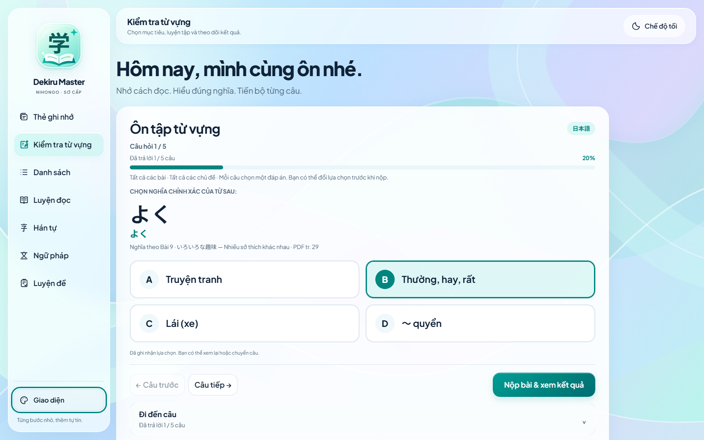
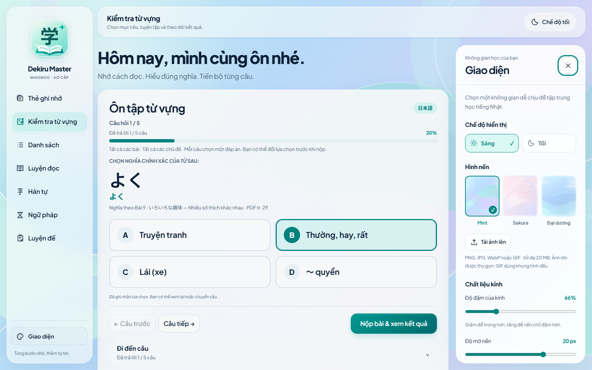

# Đối chiếu ảnh mẫu — 23/10/2026

[Báo cáo thay đổi và các khác biệt còn lại](../../REFERENCE_UI_REPORT.md). Baseline là workspace liquid glass trước lần sửa theo ảnh đính kèm, giữ cùng trạng thái quiz khi chụp lại.

## Ảnh quiz trước/sau

| Kích thước/trạng thái | Trước | Sau |
|---|---|---|
| 1600×1000, sáng | [Trước](before-quiz-1600-light.png) | [Sau](after-quiz-1600-light.png) |
| 1600×1000, tối | [Trước](before-quiz-1600-dark.png) | [Sau](after-quiz-1600-dark.png) |
| 1440×900, sáng | [Trước](before-quiz-1440-light.png) | [Sau](after-quiz-1440-light.png) |
| 1440×900, tối | [Trước](before-quiz-1440-dark.png) | [Sau](after-quiz-1440-dark.png) |
| Mobile 390×844, sáng | [Trước](before-quiz-390-light.png) | [Sau](after-quiz-390-light.png) |
| Mobile 390×844, tối | [Trước](before-quiz-390-dark.png) | [Sau](after-quiz-390-dark.png) |
| Drawer mở, 1600 sáng | [Trước](before-drawer-1600-light.png) | [Sau](after-drawer-1600-light.png) |
| Drawer mở, 1600 tối | [Trước](before-drawer-1600-dark.png) | [Sau](after-drawer-1600-dark.png) |





Các ảnh so sánh có đúng cùng câu **よく**, thứ tự A–D và lựa chọn B; seed 92713 chỉ áp dụng tạm trong browser context kiểm thử trước thao tác Start thật, được bỏ ngay sau đó. Không ép câu hỏi/phương án vào sản phẩm. [before-screens.json](before-screens.json), [after-screens.json](after-screens.json), [preservation.json](preservation.json) lưu trạng thái để đối chiếu.

## Các màn khác và nền chi tiết

- [Ngữ pháp đang làm](qa-grammar-active-desktop.png), [luyện đề đang làm](qa-exam-active-desktop.png).
- [Ảnh nền nhiều chi tiết, chữ 20 px](qa-detailed-image-ui20-desktop.png), [bản 320 px](qa-detailed-image-ui20-mobile.png). Ảnh caro là fixture cố ý dùng để thử tương phản, không phải nền mặc định.
- [Drawer 320 px](qa-drawer-320-light.png), [tablet 768 px](qa-quiz-768-light.png), [mobile tối](qa-quiz-390-dark.png).
- [Chữ Nhật và lựa chọn trên Firefox](firefox/qa-quiz-390-light.png). Không dùng ảnh Chromium để thay bằng chứng Firefox.
- [Zoom trang gốc 200% — ngữ pháp](regression/after-native-zoom-200-grammar-light.png), [drawer tối](regression/after-native-zoom-200-drawer-dark.png). Metadata tại `regression/native-zoom.json` xác nhận viewport CSS 720/DPR 2 trong cửa sổ 1440.

## Tái tạo và kiểm thử

```powershell
python scripts/capture_reference_ui.py after
python scripts/compare_reference_ui.py
python tests/check_reference_ui.py
```

Giữ `before` đã có nếu muốn so sánh đúng lần sửa này. Chỉ chạy `capture_reference_ui.py before` trước một vòng thay đổi mới. Mở trực tiếp các ảnh để xem; script đối chiếu kiểm tra trạng thái/hash, không chấm điểm giống ảnh bằng pixel.

- [Kiểm thử thị giác/chức năng mới](reference-ui-results.json): 5 kích thước 1600/1440/768/390/320, sáng/tối, cỡ chữ thực, teal và badge, drawer/focus, ảnh chi tiết/UI20, giữ bài, cài đặt cũ và file/Pages.
- [Kết quả tập trung Chromium](focused-chromium-results.json), [Firefox](focused-firefox-results.json); [toàn bộ 20/20 suite Python đạt](test-results.json), [hai kiểm tra Node/format và phạm vi](verification.json).
- `regression/`: ảnh/số đo của bộ hồi quy cũ trên giao diện mới; gồm 7 chế độ, 4 kích thước sáng/tối, UI20, đang làm/kết quả và native zoom.
- [Hash baseline](before-hashes.json), [đối chiếu bảo toàn](preservation.json): 11 file dữ liệu giống trước sửa, sáu trạng thái quiz giống nhau.
- [Hash source cuối](final-source-hashes.json), [số đo tải cuối](after-metrics.json): 929.860 byte/24 request/568 DOM, không phải thời gian tải.

Đã trực tiếp xem ảnh và sửa các sai lệch lớn: chữ đáp án 13 px, logo nhỏ, tím thay teal, header phẳng, bảng số chiếm chỗ, nút nộp dưới viewport và chữ giới thiệu trên nền nhiều chi tiết. Nội dung Nhật/cách đọc/nguồn có thể dài hơn mẫu FIFO; các phần phụ vẫn cuộn được thay vì cắt chữ.
